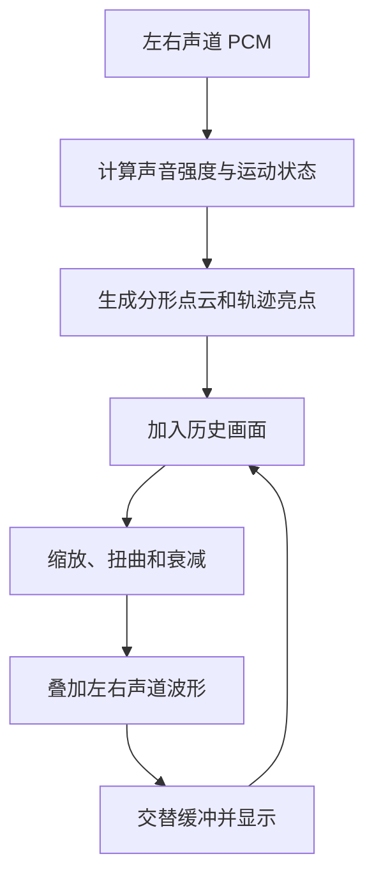

# TTPlayer 5.7.9「梦幻星空」实现分析

日期：2026-10-26。对象：本目录保存的原版 TTPlayer 5.7.9 与配套 ttpcomm.dll。

阅读提示：第 1–11 节记录二进制证据、精确行为和重建差异；第 12 节按画面生成过程逐层解释实现，包含直观例子、流程图和便于理解的伪代码。

## 1. 结论

“梦幻星空”是**由音乐驱动的分形点云、参数轨迹亮点、双声道波形线，以及历史图像反馈变形组成的二维效果**。

播放器在独立线程取得音频，调用 `ttpcomm.dll` 的 90–93 号导出；DLL 在 CPU 上生成像素，播放器负责显示和全屏拉伸。这条路径没有 GPU 粒子系统，也没有每颗星独立的三维坐标、速度和寿命。

核心控制流与历史 Goom 系列高度对应。现有重建采用 Goom 1.9.3 作为适配基础，但**尚不能凭此认定原版恰好使用未经修改的 Goom 1.9.3**。二进制中有不同的音量系数、随机表、对象布局、浮点舍入和缓冲顺序。

本轮是分析，未修改播放器或 DLL 实现，未重新运行 XP／Win7／Win11 动态测试。

## 2. 证据身份与可信范围

| 文件 | 大小 | SHA-256 |
| --- | ---: | --- |
| 原版 `TTPlayer.exe`，版本 5,7,9,0 | 1,882,544 | `c7999ea5823469c1684148cac1bd196009824348ccac5cdd45978f8fb574e28c` |
| 原版 `ttpcomm.dll` | 206,848 | `e349ef73e8a1d35b2c5debd2ddaeb5cc2513a90647766b7339d2605b34483b33` |

本轮按 reverse-engineer-anything 技能复用已有 Ghidra 伪代码和 dumpbin 汇编，并将关注地址的机器字节重新映射到上述原文件核对。当前会话未连接 REA 原生分析工具，未修改工具配置，也没有把普通文件检查包装成新的 REA Evidence。

- DLL：核对 `6001D85E–600211DB`、`60026000–60026076` 内 4,880 条地址行所列的 14,471 个机器字节，零差异；未计 dumpbin 换行续列字节，不代表全 DLL 核验。
- EXE：核对宿主相关 26 个函数范围的 7,555 字节及默认值分支的 229 字节，共 7,784 字节，包含换行续列字节，零缺失、零差异。
- 常量：按 PE 节表把虚拟地址映射到文件偏移，直接读取数值。
- 历史测试：单独列出，不当作本轮重新执行结果。

主要证据入口：

| 编号 | 来源 | 用途 |
| --- | --- | --- |
| S1 | [TTPlayer.exe 原版伪代码](../../reverse/decompiled/TTPlayer.exe.pseudo.c) | 菜单、采样、线程、绘制、全屏 |
| S2 | [ttpcomm.dll 原版伪代码](../../reverse/decompiled/ttpcomm.dll.pseudo.c) | 四个导出与算法 |
| S3 | `tests/ttpcomm_rebuild/reference-disasm.txt` | 修正 PCM 参数和 x87 伪代码失真 |
| S4 | `tests/ape_analysis/host/TTPlayer.disasm.txt` | 宿主寄存器传参和读取分支 |
| S5 | `ttpcomm/build/downloads/wgoom-1.9.3-src/goom-1.9.3/src/` | 历史实现对照、辅助命名，不能代替原版证据 |
| S6 | [重建状态与历史测试条件](../../ttpcomm/docs/RECONSTRUCTION_STATUS.md) | 区分已恢复部分和原版缺陷 |

完整本地工作笔记：`rebuild/tests/starfield_analysis_20261026/core-notes.md`、`host-notes.md`。测试资料保持在私有 tests 目录。

## 3. EXE 和 DLL 的分工

### 3.1 宿主调用链

```text
视觉类型 Type=1／菜单命令 0x8086「梦幻星空」
  → VisualCtrl 视觉子窗口（控件 ID 0x7DDC）
  → CPlayerWnd::Run（0045F12D）
  → 按视觉类型请求音频数据（00457AAD → 004ABBDC）
  → 更新视觉控件（00457B11）
  → 梦幻星空包装（0045692F）
  → ttpcomm.dll ordinal 92（6001DCFF）
  → 得到 32 位像素缓冲
  → DrawDibDraw 显示（0045697F）
```

`00457AAD` 对梦幻星空选择“不做 FFT、取得双声道 PCM”。频谱分析选择另一条 FFT 路径，不能把频谱的 105 号导出解释成梦幻星空的内部输入。

### 3.2 四个导出

以下为按汇编恢复的语义签名，函数名是便于理解的命名：

```cpp
void* __fastcall Create(unsigned width, int height);                 // 90
void  __fastcall Resize(void* object, unsigned width, int height);  // 91
const uint32_t* __fastcall Process(
    void* object, const int16_t* left, const int16_t* right,
    int forceMode);                                                // 92
void  __fastcall Destroy(void* object);                            // 93
```

| 导出 | 原版地址 | 作用 |
| ---: | --- | --- |
| 90 | `6001D85E` | 分配对象、两个像素缓冲、滤镜、IFS、两条波形线 |
| 91 | `6001D9C4` | 改尺寸并重建相关缓冲 |
| 92 | `6001DCFF` | 送入左右各 512 个 signed short，推进一次效果 |
| 93 | `6001DAAD` | 释放对象及相关状态 |

x86 下 `Process` 的 ECX 是对象，EDX 是左声道地址，右声道地址与模式放在栈上。旧伪代码把 EDX 错认成 float，直接照抄会得到错误接口。

原版播放器给模式参数固定传 **0，即自动变化**；DLL 内部支持更多模式，并不代表播放器菜单也提供了这些选项。

## 4. 音频怎样驱动画面

### 4.1 取样与强度

输入为左右声道各 512 个 16 位采样。原版在成功向输出设备提交 PCM 后，把同一批数据写入视觉环形缓冲；查询时参考输出设备报告的播放位置，使视觉读取点跟随播放进度。

`004ABBDC` 请求 `512*nBlockAlign` 字节，转换为 16 位数据后抽取前两个声道；单声道复制为两份。8 位输入减 128 再左移，24／32 位整数取高 16 位。这里没有把所有多声道信号混成两个声道，也不向 Dream 导出传入采样率或时间戳。

这条缓冲读取会消费数据，不能把它理解成任意回看、每次严格重新切片的音频历史库。原版怎样把设备游标误差传播到视觉时刻，仍需运行测量。

DLL 的整体强度取：

```text
P = max(0, left[0], left[1], …, left[511])
```

这是**左声道最大正值**。它不是绝对峰值、均方根音量、频段能量或 BPM；负半周不会直接增大 P，右声道仍参与后面的波形绘制。

从原版语义看，交换声道、改变采样窗口或将正峰改为双声道 RMS，都可能改变效果，不能当作无差别的清理。

### 4.2 速度和扩张

用 `s` 表示旧速度，原版核心计算可概括为：

```text
d = floor(P/5000) - 1 - (s>5 ? 1 : 0) - (s>20 ? 1 : 0)
s = clamp(min(s,40) + d, 0, 40)
扩张 = min(1.5, (P*0.0002f + s*0.025f) * (2/3 的 float 常量))
```

位置：`6001DD2D` 后；常量地址 `60027EA0/60027EA4/60027E9C/60027E98`。

**原版使用 `0.0002f`。** 对照的 Goom 1.9.3 源码使用 `1/50000`，小了 10 倍。直接拿上游实现替换，会使音量引起的扩张程度明显不同。

### 4.3 音乐事件与自适应阈值

- 比较的是本帧速度变化 `d` 与阈值，阈值初值为 2。
- 达到条件后打开约 20 次更新的活跃窗口，并允许调整变形方式。
- 另有常见 50、75、100 次更新的切换冷却，以及长时间无变化时的保护分支。
- 每 100 帧检查事件数：没有事件且阈值大于 1 时降低阈值；事件达到 16 次时提高阈值。

因此它会随音乐强弱变化，但并没有先识别节拍时间轴再把动画吸附到每一拍。

## 5. 画面由哪些层组成

### 5.1 IFS 分形点云

关键函数：`6001F7BE`、`6001F687`、`6001FCD1`、`6001FAC1`、`6001F97C`、`60020A66`。

IFS 即“迭代函数系统”：对点反复施加一组平移、缩放和旋转变换，生成成簇、卷曲或放射状的复杂结构。

原版每组随机选择 2–5 个变换，对应递归深度 10、6、4、2。坐标运算大量使用小数位为 12 的定点数，单位为 4096；负数的算术右移也是效果的一部分。

变换参数不会突然全部跳到新值，而是使用四组控制参数做三次 Bézier 插值：

```text
M(t) = (1-t)^3*M0 + 3*(1-t)^2*t*M1
     + 3*(1-t)*t^2*M2 + t^3*M3
t = count * 6 * 0.001f
```

约 167 次 IFS 更新后续接下一段，并延续端点切线。因此点云可以不断改变形状，而不只是把同一张星空图片旋转。

显示层每点通常写一个像素，并把另一缓冲的同位置颜色作饱和相加。分形退场通过增大“隔多少个点画一个”的抽样步长实现；恢复时在约 5 次更新中逐渐回到密集显示。

点云亮度另有 80 次更新的明暗循环，基色按内部三组通道变化规则推进。它没有逐星独立的出生、衰老和消失计时器。

### 5.2 五组十字亮点

关键函数：`600208A9`。

这层在分形不处于密集显示时出现。速度不同，每次绘制 5、10 或 15 个轨迹点。单点位置为：

```text
x = centerX + trunc(Ax*cos(float(T)/Tx))
y = centerY + trunc(Ay*sin(float(T)/Ty))
```

振幅受前面的音量扩张控制；周期和相位各不相同，所以轨迹可以交错、绕行和扩散。每个点由 3×3 范围内的五个像素组成十字，中心为白色，四臂使用该组颜色。

五组四臂颜色为 `FFFF33`、`FFCC00`、`5500FF`、`000000`、`FFFFFF`。黑色组仍有白色中心。

旧亮点的轨迹不会靠保存一长串粒子位置维持，而是留在历史画面中，继续被后面的反馈变形搬移和衰减。

### 5.3 左右声道波形线

关键函数：`6001F3B7`、`6001EF7C`、`6001F48A`、`6001EC3D`。

每声道有一条 512 点曲线，基础形状可以是圆、水平线或垂直线。采样沿每点的方向挤动曲线：

```text
x[i] = trunc(baseX[i] + cos(angle[i])*0.001f*pcm[i])
y[i] = trunc(baseY[i] + sin(angle[i])*0.001f*pcm[i])
```

相邻点连成 511 段，并用饱和加色叠到图像里。初始两条线分别从上、下边缘的水平线，趋向大小不同的圆。

形状和颜色也逐帧缓动：

```text
形状 = (39*当前形状 + 目标形状)*0.025f
颜色字节 = (63*当前颜色 + 目标颜色) >> 6
```

因此看到的环形震动、交织曲线和被拉开的线条，都可能来自真实 PCM 波形，而不只是随机光线。

## 6. 拖尾、扩散和扭曲的来源

### 6.1 整张历史画面的反馈

关键函数：`60020131` → `6002110B` → `60026000`。

滤镜为画布中每个像素准备“到上一张图的哪里取颜色”的坐标。每次更新反复对历史图像做缩放、扭曲、剪切或波动，新加入的亮点与线条也会进入这条反馈链。

这解释了为什么画面可以形成光束、隧道和流动的星云：既有新点运动，也有整张旧图像在移动。

### 6.2 八种内部变形

名称用历史 Goom 源码辅助标注；编号和右栏行为由原版二进制核实。

| 内部编号 | 对照名称 | 原版主要变形 |
| ---: | --- | --- |
| 0 | NORMAL | 基本径向缩放 |
| 1 | WAVE | 按半径平方索引正弦表，调制缩放 |
| 2 | CRYSTAL_BALL | 在速度因子上加半径平方项 |
| 3 | SCRUNCH | 减去较弱的半径平方项 |
| 4 | AMULETTE | 减去更强的半径平方项 |
| 5 | WATER | 使用逐行偏移和波动状态 |
| 6 | HYPERCOS1 | 对横纵坐标加入交叉正弦扭曲 |
| 7 | HYPERCOS2 | 更强的交叉扭曲，并采用固定速度因子分支 |

自动模式按随机表 `%28` 的分支给它们不同权重，还会改变中心、反向、平面偏移、波纹和噪声。切换使用新旧坐标映射插值，不必立即整屏换形。

DLL 的 `forceMode=1..8` 对应上述 0..7；`0` 是自动。`-1` 会压制本次的新参数，但仍有其他状态和长周期刷新分支，不能解释成“整幅动画完全冻结”。

### 6.3 残影为什么会逐渐消失

重采样使用带 4 位小数的坐标，从四个邻近像素取加权颜色。权重接近双线性插值，但每个非零乘积会减 1。

- 普通小数位置的权重和为 252。
- 单轴落在整数位置时通常为 254。
- 两轴均为整数位置时为 255。
- 最终统一右移 8 位，即除以 256。

所以每次反馈都会损失少量亮度。它不是额外覆盖一层半透明黑色，也不是逐颗星计算 alpha 淡出。

原版使用 MMX 饱和加法和加权像素处理；高字节参与部分计算，不应直接解释成现代透明合成意义上的 alpha。

## 7. 一帧的准确顺序

设进入 `Process` 时两块工作像素分别为 S、D：

```text
读取 PCM，更新强度/速度
  → IFS 向 S 加点，底色取 D
  → 向 S 画十字点
  → 选择/推进反馈映射
  → 把 S 变形重采样到 D
  → 左右波形线画到 D
  → 帧计数加一
  → 交换工作指针
  → 返回交换前的 S
```

**本次刚写好的 D 并不是本次立即返回的画面。** 它进入下一次处理，形成一帧流水。IFS 点坐标本身也有交替缓冲。因此重写时即使各公式相同，改变处理顺序仍会造成不同画面。

## 8. 显示、全屏、帧率和停止

### 8.1 普通窗口与全屏

普通状态使用皮肤提供的视觉区域尺寸。任一维小于 2 时，宿主释放梦幻星空对象。

全屏路径 `0045775A` 分别限制内部宽高：

```text
内部宽 = min(窗口宽, 320)
内部高 = min(窗口高, 240)
```

这是两个维度分别限幅，**不是按显示器比例求一张等比 320×240 缩略图**。生成低分辨率画面后，`0045697F` 用 `DrawDibDraw(..., 0x1000)` 拉伸到目标矩形。宽屏全屏的可见形状也受到这次拉伸影响。

原版该效果是 32 位 DIB 的不透明绘制，视觉全屏使用黑色背景。它没有类似星环效果的可选背景照片、徽标或透明星层。

### 8.2 刷新方式

默认配置函数 `00401E96` 将视觉帧率设为 **25 FPS**（`00402274`），默认视觉类型为频谱分析 Type 2。开启梦幻星空后沿用这个全局帧率。不能把 FPS 为零时的后备等待误当成默认帧率。

`CPlayerWnd::Run` 使用独立工作线程，第一次处理前和每次处理后都等待：

```text
FramesPerSec 非零：1000 / FramesPerSec 毫秒（整数除法）
FramesPerSec 为零：50 毫秒
```

原版每轮处理之后再等这一段时间，实际周期还要加取样、计算和绘制耗时。因此“设定 40 FPS”不是严格锁定每 25 ms 一帧。

效果中的 20／70／80／100／167／200 等周期大多以更新次数计数；提高 FPS 会让实际时间中的形变、冷却和衰减加速。若将显示率直接提高到 120／240 FPS，这一点尤其明显。

### 8.3 暂停、停止与短读

- 宿主只在音频状态为播放时送入新帧；暂停保持已显示的画面。
- 停止清理路径 `00457BCF → 004569C3` 清零最后返回的像素缓冲，但并不等同于销毁全部 Dream 对象、清零所有全局状态。
- `004ABBDC` 在音频读取返回 0 时拒绝更新；**正数短读仍进入后续固定 512 点处理**，尾部有沿用旧工作区数据的可能。现有说明文档中的“取得完整 512 点才更新”应当按重建版策略理解，不能反推成原版事实。

暂停期间另外换肤、切换效果或重设尺寸仍可重配画面；上述暂停保持指没有这些额外操作。静音但仍处于播放状态时，只要查询成功，原版仍送入全零 PCM 并更新效果。

### 8.4 菜单与歌词同屏

- 普通视觉区左键释放按 `0→1→2→3→4→0` 轮换；全屏只在梦幻星空、频谱、示波三种动态效果之间轮换。
- 从不显示或专辑封面进入视觉全屏时，原版会改为梦幻星空。
- 歌词同屏的窗口位置、歌词占比和视觉覆盖区域由 EXE 的 `FullScreen` 设置控制，不在 Dream DLL 里。
- 原版的 `LrcSizeGoom=2` 表示歌词区占底部约 20%；是否让视觉覆盖歌词后方还取决于布局与透明条件。

### 8.5 可配置范围

原版视觉选项的 FPS 滑条为 **10–40**，修改后影响后续线程等待。全局保存项是 `Visual/Type`、`Visual/FramesPerSec`；全屏另存 `PosRelationGoom`、`LrcSizeGoom` 等布局项。

已追踪的 Dream 调用只传尺寸、两段 PCM 和自动模式 0，未见独立“星数、星色、速度、灵敏度”设置入口。频谱颜色和示波模糊选项属于另外两种效果，不控制梦幻星空。

## 9. 随机性、共享状态和原版边界

对象主体大小为 `0x40088`，包含两个 128 字节对齐的像素缓冲指针、两条波形线、内嵌滤镜与 IFS 指针。滤镜还分配三块每像素两个坐标的映射缓冲。

但宽高、随机表和多组效果计数是 DLL 全局状态。原版创建会改写这些全局量，销毁会释放共享随机表，不能据“有对象指针”就判断可以安全并行运行多个不同尺寸实例。

两处影响精确对照的历史行为：

1. **随机表尾项未初始化。** 分配 16,384 个 short，只填前 16,383 个；创建后游标恰好指向最后一项。即便固定随机种子，也不能忽略堆内容的影响。
2. **正弦表边界读到相邻字段。** 实际填充 65,535 项，但索引可到 65,535；该位置对应相邻速度字段。改成普通完整 65,536 项正弦表，会改变对应边界画面。

另有 x87 中间舍入、定点负数右移、重复随机表达式的索引推进等细节。它们说明“数学上相近”与“和原版逐像素一致”是不同目标。

## 10. 与现有重建版的关系

### 10.1 已有恢复

当前实现位于：

- [ttpcomm/src/dream.cpp](../../ttpcomm/src/dream.cpp)：导出 ABI、对象与缓冲管理。
- [ttpcomm/cmake/adapt_dream.py](../../ttpcomm/cmake/adapt_dream.py)：按原版差异适配历史 Goom 源码。
- [player_window_visual.cpp](../src/ui/player_window_visual.cpp)：采样、调用和显示。

现有代码已恢复 `0.0002f`、随机表取数规则、负数右移、浮点舍入、反馈系数和交替缓冲顺序。随机尾项固定为 0；正弦边界以显式方式保留原版数值结果；另补尺寸检查、分配失败处理和共享状态串行保护。

这套梦幻星空属于 `ttpcomm.dll` 的既有能力，和可选 `ttp_osu.dll` 中的“节拍星环”“星环 lazer”是不同效果。

### 10.2 历史验证能证明什么

已复查以下本地旧日志和测试源码：

- `tests/ttpcomm_rebuild/dream.cpp`
- `dream-final-win11.log`：8,900 帧，15 组，零不匹配帧。
- `dream-final-xp.log`、`dream-final-win7.log`：各 8,000 帧，15 组，零不匹配帧。

覆盖自动／指定模式、尺寸变化、不同种子、静音和突发信号等。

**前提：测试将参考 DLL 运行内存里的未初始化随机尾项置为 0。没有修改参考 DLL 文件。** 这些结果证明对应条件下的核心像素输出，不证明任意堆状态、所有输入、宿主音频窗口与最终桌面像素都完全相同，也不属于本轮重新测试结果。

### 10.3 本轮确认需要区分的宿主差异

| 项目 | 原版 | 当前重建／判断 |
| --- | --- | --- |
| 刷新节奏 | 计算与绘制后等待整数毫秒 | 当前使用 deadline，并把处理耗时计入周期；相同名义 FPS 不保证相同实际帧数 |
| 最终绘制 | `DrawDibDraw` | 当前 `StretchDIBits`、`COLORONCOLOR`；确认 API 不同，尚不能据此断言所有尺寸的屏幕像素不同 |
| 音频短读 | 非零即继续固定采样处理 | 重建采用完整采样窗口策略；属于边界差异 |
| 多实例 | 多组 DLL 全局状态，没有完整独立性 | 重建串行保护并恢复实例尺寸，但不等同于每个实例拥有独立随机时间线 |
| 未初始化/越界 | 依赖堆内容和相邻字段 | 重建使用确定初始化、显式边界行为和内存检查 |

## 11. 后续建议

1. **保留现有核心基线。** 不宜用通用 GPU 星粒子、FFT 环形频谱或未经适配的新版 Goom 代替，视觉组成和数值都不同。
2. **优先补宿主端对照。** 固定同一 PCM 序列、种子、尺寸和调用次数，分别比较 DLL 原始像素与窗口最终像素；再测暂停、停止再播放、短读和跨尺寸切换。
3. **若提升平滑度，分开逻辑更新和显示。** 保持旧效果按选定基准速率推进，显示端可提高刷新率；这是可选现代化方案，不应称为原版原样行为。
4. **若增加高分辨率模式，保留原版 320×240 模式。** 内部尺寸改变会影响点坐标、线宽、速度感和滤镜映射；只换高分辨率不是无差别优化。
5. **若需要多个视觉窗口独立播放，再拆分全局状态。** 需明确不同实例的随机序列与切换状态，不只增加一把锁。

尚未覆盖：本轮未采集新的原版屏幕帧、未测真实帧间隔、未穷尽所有随机/坏参数路径，也未确认其他 TTPlayer 发行包使用同一 DLL。上述分析结论限定于第 2 节的二进制。

## 12. 从声音到星空：逐层实现说明

理解原版“梦幻星空”的关键，是把它看成一个**不断向旧画面加入新内容，再让整张画面变形、移动和变暗的循环**。

星点、光环、拖尾和星云，都是这个循环逐帧积累出来的。下面按照原版实际处理过程展开说明。公式和伪代码在本节按语义简化，用于解释原理；精确常量、舍入和缓冲边界以前面各节的二进制分析为准。

### 12.1 为什么会形成“星空”

假设在黑色画布中央画一个亮点：

1. 下一帧，把旧画面稍微向外放大，亮点就向外移动。
2. 放大的同时降低一点亮度。
3. 在中央附近再画一个新亮点。
4. 重复上述过程。

若连续执行，画面上就会出现一串从中央向外延伸、逐渐变暗的亮点。

再把“向外放大”改成带有旋转感、波纹或横向偏移的坐标变换，轨迹就会弯曲、扩散、卷成光束。

**梦幻星空正是在这个反馈循环里，不断加入分形点云、轨迹亮点和音频波形。**



这里的“历史画面”本身就是动画状态的一部分。上图概括各层之间的关系；两块缓冲的具体返回顺序见第 12.8 节。

### 12.2 播放器如何把声音送给效果

原版播放器负责从音频输出链取得数据，然后调用 `ttpcomm.dll` 的 **92 号导出**。

每次输入：

```cpp
int16_t left[512];   // 左声道，512 个有符号 16 位采样
int16_t right[512];  // 右声道，512 个有符号 16 位采样
```

单声道会复制成两份；多声道在这条路径里抽取前两个声道。

这些数据来自播放器已经提交到输出链的 PCM，并参考设备播放位置调整读取点。效果函数收到的是：

```text
当前声音波形 + 效果内部状态
```

它没有收到歌曲时间戳、采样率或每帧经过多少毫秒。动画推进主要依赖调用次数。

例如，44.1 kHz 下的 512 个采样约覆盖 **11.6 毫秒声音**；原版默认视觉刷新率为 25 FPS，因此音频采样窗口长度和视觉刷新间隔是两个不同的量。

### 12.3 声音强弱怎样改变运动

#### 12.3.1 先取得左声道正峰

原版扫描左声道：

```text
P = max(0, left[0], left[1], …, left[511])
```

也就是取这段波形中最大的正值。

右声道仍然参与后面的波形绘制，但这个控制整体运动的强度值主要来自左声道。

#### 12.3.2 强度改变运动速度

用 `s` 表示上一帧的速度，在正常的 0～40 状态范围内，原版执行过程可概括为：

```text
d = floor(P / 5000) - 1
    - (s > 5  ? 1 : 0)
    - (s > 20 ? 1 : 0)

s = clamp(s + d, 0, 40)
```

可以把它理解成：

- 声音较强时，给运动增加推动力。
- 当前速度越高，阻力越大。
- 声音变弱后，速度逐步降下来。
- 最终速度限制在 0～40。

所以它有一定惯性，声音刚变弱时不会立即静止。

#### 12.3.3 强度还改变运动范围

轨迹扩张系数为：

```text
扩张 = min(1.5, (P × 0.0002 + s × 0.025) × 2/3)
```

这个值用于放大亮点的运动范围。

例如在速度较低时：

- `P=5000`，扩张约为 `0.67`。
- `P=15000`，扩张很容易达到上限 `1.5`。

这里的 **`0.0002f` 是原版二进制中的实际常量**，恢复时必须保留。

### 12.4 第一层：分形点云怎样生成

这是画面中大量复杂星云形状的重要来源。

原版使用 **IFS，迭代函数系统**。它的基本思想是反复对点进行坐标变换。

可以用一个简化公式理解：

```text
新 x = a × x + b × y + 平移 x
新 y = c × x + d × y + 平移 y
```

其中的系数包含缩放、旋转等信息。不断把得到的新点继续送入变换，就会生成复杂的点群。

#### 12.4.1 原版如何控制复杂程度

原版随机选择 2～5 个变换：

| 变换数量 | 对应递归深度 |
| ---: | ---: |
| 2 | 10 |
| 3 | 6 |
| 4 | 4 |
| 5 | 2 |

变换分支越多，递归深度越小，以控制生成量。

这些是生成坐标的规则，不能直接当成屏幕上的星点数量。

#### 12.4.2 点云为什么能连续变形

原版保存四组控制参数，通过三次 Bézier 插值逐步过渡：

```text
M(t) = (1-t)³M0
     + 3(1-t)²tM1
     + 3(1-t)t²M2
     + t³M3
```

大约每 **167 次分形更新**续接一段新的变化。

因此，点云可以逐渐从一种形状扭成另一种形状，形成连续的展开、卷曲和收缩。

#### 12.4.3 点云怎样退出

原版通过逐渐增大绘制步长，让点云变稀：

```text
每个点都画
→ 每隔几个点画一个
→ 每隔更多点画一个
→ 暂停绘制
```

恢复时再逐步变密。已经留下的图像继续参与反馈，因此退场过程还带着残影。

### 12.5 第二层：几个明亮的星点怎样移动

除了密集点云，还有一层较少但明亮的十字点。

每个点的位置大致为：

```text
x = 中心 x + Ax × cos(T / Tx)
y = 中心 y + Ay × sin(T / Ty)
```

这里：

- `Ax、Ay` 控制横纵运动范围。
- `Tx、Ty` 控制横纵运动周期。
- `T` 是持续增加的运动计数。
- 不同组使用不同周期和相位。

横纵周期不同，轨迹就会交错、绕行。

原版有五组这样的轨迹。根据当前速度，每帧绘制 **5、10 或 15 个亮点**；这一层在 IFS 不处于密集显示状态时启用。

单个亮点只有五个像素：

```text
· 彩 ·
彩 白 彩
· 彩 ·
```

白色中心和彩色四臂形成十字。旧位置的亮点留在反馈画面里，再被缩放和扭曲，于是少量新点也能形成长轨迹。

### 12.6 第三层：声音波形怎样变成光环和线条

左右声道各有一条 **512 点曲线**。

曲线的基础形状可以是：

- 圆形；
- 水平线；
- 垂直线。

然后，音频采样沿各点的指定方向推动它：

```text
x[i] = 基础 x[i] + cos(方向[i]) × 0.001 × PCM[i]
y[i] = 基础 y[i] + sin(方向[i]) × 0.001 × PCM[i]
```

例如：

- 水平线上的点主要上下波动。
- 垂直线上的点主要左右波动。
- 圆上的点沿相应方向扩张、收缩。

每两个相邻点连接成线段，所以它是一条连续波形。

#### 12.6.1 形状和颜色也有缓动

几何位置每次更新为：

```text
新位置 = (39 × 当前位置 + 目标位置) / 40
```

相当于每次向目标靠近约 2.5%。

颜色采用更慢的过渡：

```text
新颜色字节 = (63 × 当前颜色字节 + 目标颜色字节) / 64
```

因此横线变圆、颜色变化等过程会平滑展开。原版在具体计算中保留单精度常量、浮点舍入和颜色整数右移，精确复现时需保留这些差别。

### 12.7 核心：整张旧画面怎样被扭曲

原版为每个目标像素建立一个“取色位置”：

> 这个像素应该从旧画面的哪个坐标读取颜色？

例如目标位置 `(100,100)`，可能被安排到旧画面的 `(98.5,97.8)` 附近取色；原版实际坐标会量化到 1/16 像素。

所有像素都这样重新取色，整张图就会发生变形。

原版内部提供八种主要坐标变换，包含：

- 基本径向缩放；
- 随距离变化的波纹缩放；
- 中心与边缘强度不同的径向变形；
- 逐行横向偏移；
- 横纵相互影响的正弦扭曲。

还可以改变变形中心、方向和附加偏移。

#### 12.7.1 为什么切换不会总是突然跳变

切换时保留旧、新两套坐标映射，再逐步插值：

```text
当前映射 = 旧映射 + (新映射 - 旧映射) × 过渡比例
```

这使整张画面的运动方向可以逐渐改变。

#### 12.7.2 为什么残影会变暗

取色位置通常包含小数，需要混合附近四个像素。

原版的权重刻意略小于完整亮度：

- 常见权重总和为 252；
- 最后统一除以 256。

例如四周都是亮度 255：

```text
255 × 252 / 256 → 截断为 251
```

下一轮继续处理，又会变暗一点。

于是形成：

```text
新内容明亮
→ 被反馈搬移
→ 多次采样
→ 逐渐变暗
→ 最后消失
```

这是梦幻星空拖尾的重要来源。落在整数坐标等边界时权重不同，详见第 6.3 节。

### 12.8 每一帧的真实执行顺序

原版有两块像素缓冲，记为 A、B。

按语义整理后的流程是：

```cpp
读取声音强度();
更新速度和切换状态();

把分形点云画到(A);  // 加色时读取 B 中的历史底色
把十字亮点画到(A);

把A变形并衰减到(B);
把左右声道波形画到(B);

本次显示 = A;
交换(A, B);

return 本次显示;
```

这里有个很重要的细节：

**本次新增的波形和变形结果通过后续更新进入显示；本次加入 A 的点云和亮点则可以已经可见。**

这是一种交替缓冲的流水顺序。恢复时如果把它改成“全部画完直接返回 B”，画面会发生变化。

### 12.9 音乐为什么会触发形态变化

原版会观察前面计算的速度变化量，与一个可调整阈值比较。

满足条件后：

1. 打开一段活跃窗口；
2. 按随机规则选择变形；
3. 可能移动中心、调整方向或切换线条形状；
4. 设置冷却，避免连续过快切换。

它还会根据最近的触发次数调整灵敏度：

- 长时间没有事件，就降低阈值。
- 事件过于频繁，就提高阈值。

所以它能适应不同强度的音乐，但形态变化仍包含明显的随机成分。

### 12.10 原版画面质感还来自分辨率和计时

原版默认 **25 FPS**。全屏内部尺寸分别限制为：

```text
宽度最多 320
高度最多 240
```

生成后再拉伸到屏幕。

这会让低分辨率亮点、波形和拖尾一起放大，形成原版特有的视觉质感。

另外，很多变化都是按帧推进的：

- 波形每帧靠近目标；
- 反馈每帧损失亮度；
- 点云每帧推进变形参数；
- 冷却每帧减一。

因此，直接提高到 120 或 240 FPS，会同时加快形变和衰减。要提高显示流畅度而保留原版速度，需要分别处理“效果更新频率”和“显示刷新频率”。这属于后续改进方案，原版没有独立的高刷新显示层。

### 12.11 小结

**梦幻星空用声音控制运动，用分形生成复杂点群，用真实波形生成曲线，再利用整张历史图像的反复变形和衰减，把这些简单元素积累成流动的星空。**

对应函数地址、完整常量、缓冲顺序及原版边界问题，见第 3–9 节；当前恢复程度和需要进一步对照的宿主差异，见第 10–11 节。
